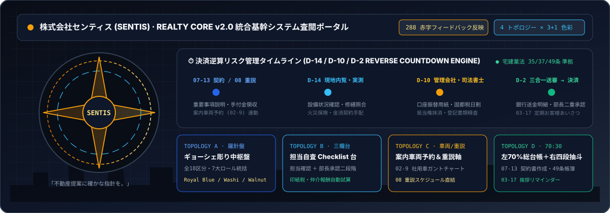

# 🏢 Vanguard-Sentis · 株式会社 SENTIS 不动产综合业务管理系统 (Realty Core v2.0)

**「不動産提案に確かな指針を。」—— 288 项客户手写反馈精校要件、9 幅端到端泳道流程图、幻灯片查阅门户与四大拓扑高保真原型**

[-F59E0B?style=flat-square)](site/index.html)

 

---

> [!IMPORTANT]
> **⚠️ 商业咨询原型与不动产/财税测算免责声明 (Legal & Tax Calculation Disclaimer)**
> 本仓库（`QQDDTT/Vanguard-Sentis`）及线上查阅门户（`https://vanguard-sentis.evotensor.dev`）所交付的要件定义书、SOP 泳道流程图、印纸税/法定中介费（`3% + 6万日元 + 税`）/非居住者源泉税测算器及高保真 CRM 原型，**仅作为信息系统要件定义（Design Review v2.0）与纯静态前端交互演示参考，不构成正式法律意见、税理士财税申报或专任宅地建物取引士（宅建士）法定第 35 条重说 / 第 37 条书面背书**。实际不动产交易须由持牌专任宅建士、司法书士及经办银行核验签署。

---

## 1. 交付成果物矩阵 (`DEL-01 ~ DEL-08`)

| 成果物编号 | 类别 | 核心名称与规格内容 | 查阅入口 |
| :--- | :---: | :--- | :--- |
| **`DEL-08`** | 📄 核心要件 | **05. 综合业务管理系统要件定义书（v2.0 精校版）**：100% 反映 **288 项手写批注**、7 大角色 (`R01~R07`) 收敛、7 大业务子系统 (`S1~S7`，剔除 `06/17`) 及 **第九章 9 幅端到端泳道流程图** | [`docs/05_requirements_definition.md`](docs/05_requirements_definition.md) |
| **`DEL-01`** | 💻 画面原型 | **内部基干管理系统 v2.0 高保真原型套件**：空间几何门禁 + **4 大拓扑（A 罗盘中枢 / B 三栏工作台 / C 看房车辆预约时间表&重说排期 / D 左70%总台账+右30%四段抽屉）× 3+1 主题色彩** | [`site/prototype-crm.html`](site/prototype-crm.html) |
| **`DEL-02`** | 💻 画面原型 | **执务室空间全景导航与罗盘数据中枢（VR Office Hub）**：360° 罗盘指挥舱、物件资料柜、决算白板与多角色业务沙盘 | [`site/crm-home.html`](site/crm-home.html) |
| **`DEL-03 ~ 06`** | 📄 基础规范 | **01 业务课题定义 / 02 买卖与跨境 SOP / 03 系统架构与 7 角色 RBAC / 04 研发推进 5 阶段日程表 / 06 测试与验证规范** | [`site/index.html`](site/index.html) |
| **`DEL-07`** | 🎨 品牌资产 | **株式会社 SENTIS 官方 CI/VI 多规格罗盘徽标与印鉴素材包** | [`site/assets/logo/`](site/assets/logo/) |

---

## 2. 目录结构与验证工具

- `docs/`：全套 Markdown 规格书（`01`~`06`），其中 `05_requirements_definition.md` 为 v2.0 288 项主权威源。
- `site/`：零后端纯静态交付门户（`index.html` 清单式主页、`document.html` 幻灯片查阅器、`prototype-crm.html` 与 `crm-home.html` 业务原型）。
- `tools/`：Windows 原生 PowerShell 自动化生成与质量门禁脚本（`gen-flows.ps1` 泳道图同源生成器、`verify-site.ps1` 自动化验证套件）。

---

## 3. 在线访问与本地离线双击体验

- 🌐 **专属独立 HTTPS 域名**：**[https://vanguard-sentis.evotensor.dev](https://vanguard-sentis.evotensor.dev)**
- 💻 **本地零环境双击浏览**：克隆仓库后直接双击打开 [`site/index.html`](site/index.html) 即可完整体验，无需安装任何本地 Server 或外部语言运行时。

---

## 4. 开源许可证 (License)

本公开案件展示仓中的脱敏前端原型代码与 SVG 视觉资产采用 **[MIT License](LICENSE)** 授权。客户原始商业资料与平台核心工具链受专有保密协议保护。
