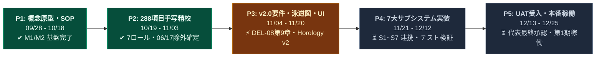

# Sentis 内部综合管理系统工程进度与里程碑规划 (Project Schedule)

> **案例标识**：`sentis-crm-system`  
> **工程代号**：Sentis Realty Core (v2.0 · 7大サブシステム / 288項目)  
> **当前阶段**：**Phase 3: 要件定義 v2.0 精校・全社泳道フロー・Horology v2 査閲フェーズ (2026-11-14 時点)**  
> **编制日期**：2026-10-03 | **最新更新**：2026-11-14  
> **负责人**：Vanguard 平台架构组 & 代表阿部翔平

---

## 1. 工程阶段推进全景图 (v2.0 5-Phase Pipeline & Gantt)

### 1.1 阶段里程碑流转管线 (2026-11-14 基準・7大サブシステム対応)

### 1.2 阶段性里程碑与交付物矩阵 (Milestones & Deliverables · v2.0)

| 阶段代号 | 周期区间 | 核心工作内容 | 关键交付物 (Deliverables) | 准出条件 (Exit Criteria) | 当前状态 (2026-11-14) |
| :--- | :--- | :--- | :--- | :--- | :---: |
| **P1: 商业基盘与买卖 SOP 原型** | 09/28 - 10/18 | 梳理《売買契約の流れ》与《創業計画書》，完成初期买卖仲介 SOP 与 CI/VI 规范 | • `01_overview.md` (DEL-03) • `02_business_workflow.md` (DEL-04) | 买卖核心链路闭环，品牌视觉确立 | ● 已完成 |
| **P2: 288项客户手写反馈精校** | 10/19 - 11/03 | 解析 13 页手写批注，确立 7 角色 RBAC (`R01~R07`)，剔除 `06_売買管理` 与 `17_融資管理` | • `05_requirements_definition.md` 第1~8章 • 7 大业务子系统 (`S1~S7`) 边界定义 | 288 项全数入表，角色与除外项 100% 锁定 | ● 已完成 |
| **P3: 全业务泳道图与高定样板评审** | 11/04 - 11/20 | 编制 DEL-08 第九章 9 幅端到端泳道流程图，升级幻灯片查阅器与 Swiss Horology v2 原型 | • `05_requirements_definition.md` 第9章 • `site/prototype-crm.html` & `crm-home.html` • `06_test_and_verification.md` | 零空白幻灯片、288 项节点全覆盖、双视口通过自动化验证 | ● 进行中 (当前) |
| **P4: 7大子系统全量联调与受入测试** | 11/21 - 12/12 | 落地 `S2` 买卖、`S3` 赁贷、`S4` 入金/物件/契约及 `S1/S5/S6/S7` 规则联动与打印模板 | • 7 大子系统状态机与数据联动 • 全场景 UAT 测试报告 | 买卖 21 项 + 赁贷 16 项 + 财务人事法务闭环零缺陷 | ⚪ 待启动 |
| **P5: 正式验收与第1期业务投产** | 12/13 - 12/25 | 阿部代表终审签收，导入第 1 期真实在办案件，启动日常运营 SOP | • 终版验收报告与运维手册 • 生产环境安全基线切换 | 代表签字验收，2 人核心团队全流程线上化运转 | ⚪ 待启动 |

---

## 3. 当前冲刺工作分解 (Current Sprint WIP - M2阶段)

### 3.1 详细设计任务清单 (Checklist)
- [x] **商业目标与技术定位融合**：完成将《創業計画書》3 年发展规划与高额房产业务融入系统定位。
- [x] **全链路业务流程规范化**：建立签约前【事前审查与买付】、签约、贷款、金消、决算各大阶段的 SOP 标准文档。
- [x] **系统管辖与外部协同边界划定**：确立 In-Scope 与 Out-of-Scope 边界矩阵，排除非现实自动承诺。
- [ ] **Checklist 规则引擎逻辑表定义**：
  - [ ] 规则 1：物件分类（一户建验房 / 公寓变更届与振替用纸）
  - [ ] 规则 2：卖方性质（法人 3 份重说 / 个人 4 份重说）
  - [ ] 规则 3：买方属地（在日无番号住民票 / 境外公证声明书［格式待定］）
  - [ ] 规则 4：佣金超额（超 3% 强制关联《支払約定書》［细则待定］）
- [ ] **决算倒排日历警报算法设计**：定义以决算日为基准的 $D-14$ / $D-10$ / $D-7$ / $D-2$ / $D-1$ 各级告警等级（红色强制、黄色提示、绿色完成）。
- [ ] **待定与合规待审议题推进**：
  - [ ] 境外大额外汇电汇受款银行 AML 反洗钱审查到账缓冲期（2~4周）［未定·要協議］
  - [ ] 非居住者预提所得税（10.21%）源泉征收扣缴与税理士委任流程［待定 / 税理士確認中］

---

## 4. 工程风险与应对策略 (Risk & Mitigation)

| 风险项 | 风险等级 | 潜在影响 | 防范与应对策略 |
| :--- | :---: | :--- | :--- |
| **管理会社邮寄延迟** | **高** | 决算前无法收到《管理费+修缮费振替用纸》，导致交房脱节。 | 系统在决算日前 10 天触发**强提醒**，生成“致电管理会社备忘与挂号信封确认项”。 |
| **住民票番号违规泄露** | **高** | 买方误开含个人番号的住民票，银行与司法书士拒收。 | 在客户 Checklist 中使用高亮红标警示，并在上传/核验时设置“无番号”强制确认复选框。 |
| **海外客户公证书时效** | **中** | 境外公证处出具声明书周期过长，影响契约与过户。 | 提前两周触发海外客户公证指引，提供多语言标准公证模板。 |
| **高额印纸税贴附遗漏** | **中** | 领收书超 100 万日元漏贴第 2 张印纸，存在审计合规风险。 | 财务结算工具内嵌逻辑锁，输入成交价与中介费后自动输出印纸张数与面额，一目了然。 |
