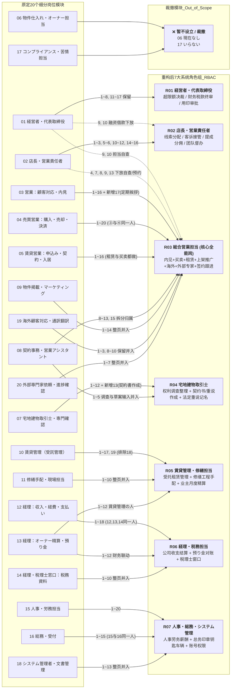

# 株式会社 SENTIS 综合业务管理系统要件定义书（基于客户手写反馈精校版）

- **文档版本**：v2.0（基于客户手写批注原件 `BRW3CEFA529E05C_000414.pdf` 全面重构）
- **编制日期**：2026-11-03
- **关联源文件**：
  - 客户手写反馈提取精校稿：[client_feedback_BRW3CEFA529E05C_000414.md](../raw/client_feedback_BRW3CEFA529E05C_000414.md)
  - 客户手写反馈扫描原件：[BRW3CEFA529E05C_000414.pdf](../raw/BRW3CEFA529E05C_000414.pdf)

---

## 一、 核心发现与需求重构总览（Executive Summary）

通过对客户在 20 页《业务角色与具体业务清单》（共 286 项印刷条目 + 2 项客户手写新增条目 = **288 项业务活动**）上的红色手写反馈进行逐字分析，我们识别出客户真实业务运作模式与传统大型不动产公司科层制之间存在 **四大根本性差异**。本要件定义书以此作为系统设计的最高准则：

### 1.1 四大核心设计转向（From As-Is Preset $\rightarrow$ To-Be Reality）

1. **业务范围重构：从“单一买卖仲介”扩展为“买卖 + 租赁 + 受托管理 + 经由人事”全能一体机**
   - 客户在第 5 页用中文明确批注：**「实际中，营业租赁和买卖都做」**，并在第 4 页批注 **「③と④おなじ営業担当のこと」**。
   - 同时客户完整勾选保留了 **10 租赁受托管理、11 修缮手配、12~14 财务经由与业主精算、15~16 人事劳务与总务、18 系统管理**。系统必须支撑买卖、租赁、受托物业管理及内部经营后台的全链路协同。
2. **组织架构重构：从“20 个细分岗位”扁平化收敛为“7 大实操角色（一人多岗兼任）”**
   - 客户在 `08`、`09`、`11`、`14`、`16`、`18`、`20` 共 7 页的标题上直接画大 `×`，并在旁边指定并入既有角色；对 `06（物件仕入れ）` 标注 **「現在なし」**，对 `17（コンプライアンス・苦情専任）` 标注 **「いなない（いらない）」**。
   - 系统不得设置繁琐的跨部门流转审批墙，必须支持**灵活的角色兼任（Multi-Role Binding）**与高度内聚的工作台。
3. **管控模式重构：从“店长/代表事无巨细审批”转向“公司级 Checklist 赋能 + 一线担当自查 + 资源自助预约”**
   - 客户将原本属于店长的报价单审核（02-4）、签约材料核查（02-7）、重说排期（02-8）、看房车辆调度（02-9）、决算延期联络（02-13）全部打 `×` / `⊗` 下放，并明确提出：**「これ会社チェックリストを作って、担者自分で確認ほうがいい」**、**「（車両）時間表作って、みんな予約制で」**、**「担者から直接宅建確認ほうがいい」**。
   - 系统的核心价值在于提供**防错自查工具（Checklist）与共享排期日历（车辆/宅建士）**，而非增加审批层级。
4. **合规流程重构：砍掉冗余的形式主义审查，聚焦核心法定动作**
   - 客户用大红 `×` 划掉了 `17 コンプライアンス` 的第 5~10 项（繁琐的可疑交易内部层报与成约抽检补件）、`19 海外顧客対応` 的第 4~7 项（将海外公证专家确认、时差提醒、跨境汇款追查作为独立模块的繁琐流程），以及 `08` 的第 6 项（因宅建士自己做合同而无需内部回付草案）和第 14 项（抽检补凭证），且未勾选 `10` 的第 18 项（定期管理报告书）。

---

## 二、 组织角色归并与 RBAC 权限架构定义（Role Consolidation）

### 2.1 原 20 个业务模块向 7 大系统角色收敛拓扑图

### 2.2 七大系统角色权责与兼任规约

| 角色代码 | 角色名称 | 涵盖原清单模块与条目 | 典型兼任配置与权限特征 |
| :---: | :--- | :--- | :--- |
| **R01** | **経営者・代表取締役** | `01`（No.1~8, 11~17） | 最高决裁权（超权限手续费折扣、大额采购/广告/工程、人事录用与调薪、税款与月度资金排期、公章特定用印）。 |
| **R02** | **店長・営業責任者** | `02`（No.1~3, 5~6, 10~12, 14~16）+ `01`（No.9~10 部长确认） | 业务管理权（分配新线索、超时未回督办、权限内折扣/报销审批、房源上架审核、分佣核定、升级客诉处理、未成约/失注复盘）。小团队期可由代表（R01）或核心骨干兼任。 |
| **R03** | **総合営業担当** | `03`（1~16+**新增17**）+ `04`（1~20）+ `05`（1~16）+ `08`（8~13, 15）+ `09`（1~14）+ `19`（1~3, 8~10）+ `20`（1~7）+ `02`下放项（4, 7, 8, 9, 13）+ `01`下放项（9, 10） | **系统最核心高频使用角色**。一人贯通：多渠道获客 $\rightarrow$ 内见带看（含公车预约）$\rightarrow$ 买卖仲介全流程 $\rightarrow$ 租赁仲介全流程 $\rightarrow$ 房源中日文上架与视频推广 $\rightarrow$ 海外客户翻译与委任协调 $\rightarrow$ 外部专家（司法书士/税理士等）跟进 $\rightarrow$ 签约与决算交割归档 $\rightarrow$ 老客户定期问候。 |
| **R04** | **宅地建物取引士** | `07`（1~12+**新增13**）+ `08`（1~5） | **法定专业确权与合同制作角色**。负责列出案件必要/不足书类清单、获取登记与调查资料、核对当事人表记、整理管理公司/行政调查结果、**直接起草作成《契约书》与《重要事项说明书》**、执行线下/线上重说并记名押印。可由具备宅建士资格的代表或营业兼任。 |
| **R05** | **賃貸管理・修繕担当** | `10`（1~17, 19）+ `11`（1~10）+ `13`（1~12） | **受托物业管理与工程精算角色**。负责受托房源台账、催租与保证公司代位申请、日常报修与巡检、退房立会与原状回复精算、空房翻新招租、修缮比价/下单/验收、以及业主月度收支精算与押金（預り金）管理。 |
| **R06** | **経理・税務担当** | `12`（1~18）+ `13`（1~12 协同）+ `14`（1~10） | **公司财务与税务窗口角色**。负责仲介费请求书与领收书开具、入金核销、供应商付款与员工报销、员工提成核算、银行对账与月结、电子凭证合规保存、业主精算资金划付、以及对接税理士（月度凭证、Invoice 适格请求书、非居住者源泉征收、年末调整、纳税）。 |
| **R07** | **人事・総務・システム管理** | `15`（1~20）+ `16`（1~15）+ `18`（1~13） | **内部运营与安全底座角色**。负责招聘入离职、考勤休假与薪资汇总、前台接待与快递合同寄送、公章用印登记、房源钥匙与门禁卡台账、公车维护保养、以及系统账号创建、权限分配、文件恢复、备份监控与安全审计日志。 |

---

## 三、 客户手写批注驱动的“六大核心专项要件”（Key Custom Requirements）

以下 6 项功能是客户在阅读标准业务清单后，用红笔直接批注或新增的**痛点级改造诉求**，必须在系统交互与数据结构中作为一等公民（First-Class Features）优先实现：

### 3.1 【REQ-SP-01】报价单与签约必要书类“担当自查 Checklist”引擎
- **客户原话依据**：
  - `02-No.4`（报价单核对）：🔴 **「× 担者自分確認」**
  - `02-No.7`（签约必要书类确认与补齐）：🔴 **「これ会社チェックリストを作って、担者自分で確認ほうがいい」** / **「⊗ まず担者自分確認」**
- **系统功能设计**：
  1. **去审批流化**：取消“营业担当生成报价单/初期费用明细/签约材料包后必须提交店长审批才能推进”的阻塞式工作流。
  2. **内置公司级标准 Checklist 模板库**：
     - **买卖签约自查清单**：根据物件类型（公寓 / 新筑一户建 / 二手户建 / 土地）、交易角色（买方 / 卖方 / 双手）、资金方式（日本房贷 / 海外全款）、当事人属性（个人 / 法人 / 非居住者），动态生成必填项（如：登记事项证明书、重要事项调查报告书、公图/测量图、本人确认书类、无个人番号住民票、印纸面额、支付约定书等）。
     - **租赁签约与报价自查清单**：募集条件（租金/共益费/敷金/礼金）、初期费用明细科目、宠物/用途特约、保证公司与火灾保险必选项。
  3. **担当自查确权留痕**：营业担当（R03）在界面上逐项勾选「担当者確認済」后即可直接推进或发送客户，系统自动记录自查时间戳与确认人，无需等待店长批复。

### 3.2 【REQ-SP-02】看房公车共享时间表与全员自助预约系统（車両予約タイムテーブル）
- **客户原话依据**：
  - `02-No.9`（同一时段多场内见时的担当、车辆、钥匙调配）：客户划掉「~~担当者~~」与「~~鍵~~」，用红圈重点圈出 **「車両」**，并手写：🔴 **「時間表作って、みんな予約制で」**。
- **系统功能设计**：
  1. **共享车辆日历视图（Vehicle Timetable）**：在系统首页与内见安排模块内置可视化的「車両予約時間表」（支持按日/周时间轴展示公司所有可用车辆，联动 `16-No.11` 车辆台账与保养状态）。
  2. **自助预约与冲突锁（Self-Service Booking）**：营业担当（R03）在安排客户内见（`03-No.7`）时，直接点选时段一键预约车辆（绑定案件、目的地、预计用车起止时间），已被预约的时段自动锁定防撞车，彻底免除店长人工协调车辆的沟通成本。

### 3.3 【REQ-SP-03】营业担当与宅建士“重要事项说明（重说）直连排期”
- **客户原话依据**：
  - `02-No.8`（与负责重说的宅建士确定实施日期时间）：🔴 **「これは担者から直接宅建確認ほうがいい」**。
- **系统功能设计**：
  1. **宅建士可约时段看板**：系统展示宅建士（R04）的日程空闲状态。
  2. **一键直连邀约**：无论是买卖签约重说（`04-No.11`）还是租赁签约重说（`05-No.10`），均由营业担当（R03）直接在案件面板发起重说时间确认（标注线下到店或线上 IT 重说），直接通知宅建士确认，不经过店长中转。

### 3.4 【REQ-SP-04】宅建士“调查整理 + 契约书/重说作成”一体化工作台
- **客户原话依据**：
  - `07-No.13`（客户手写新增）：🔴 **「13 契約書作成」**
  - `08` 顶部批注：🔴 **「宅建士：⊗ 1 2 3 4 5 6」**，且将 `08-No.6`（将做好的草案回付给营业、宅建士等确认者）直接打 **`×`** 划除。
- **系统功能设计**：
  1. **权责合一**：在 Sentis 的实际工作流中，不由助理起草合同再流转给宅建士审查，而是由 **宅建士（R04）直接包揽从资料清点到合同编制的全过程**。
  2. **宅建士专属合同工作台**：
     - 自动生成案件必要书类一览与不足书类一览（`08-1`）；
     - 归集登记情报、图纸、业主/管理公司/役所行政调查结果（`08-2, 4`）；
     - 当事人姓名、住址、法人名与证件表记一致性核验器（`08-3`）；
     - 契约书与重要事项说明书作成与条件填入（`07-13`, `08-5`），并内置“契约书 vs 重说 vs 调查资料无矛盾核验清单”（`07-3, 4`）。
     - 取消多余的“草案回付宅建士审批流”（`08-6` 已划除）。

### 3.5 【REQ-SP-05】成约与既有客户“定期问候（定期挨拶）”CRM 循环提醒
- **客户原话依据**：
  - `03-No.17`（客户手写新增）：🔴 **「17 定期的お客様あいさつする」**。
- **系统功能设计**：
  1. **客户全生命周期关系维护**：除了交房后的首次状况确认（`03-No.16`），系统需为每位成约客户及重点潜在客户配置 **「定期挨拶サイクル（定期问候周期）」**（例如：交房后 1 个月、半年、1 年周年庆、新年/中秋节令问候、租约到期前问候）。
  2. **待办自动唤醒**：到期自动在营业担当（R03）工作台生成「定期挨拶リマインド」任务，记录问候历史与客户近况（如是否有新增置业、换房、出租或朋友转介绍意向），赋能高客单价私域复购与转介绍。

### 3.6 【REQ-SP-06】公司融资申请与借款手续的“担当/部长双轨确认”
- **客户原话依据**：
  - `01-No.9 & 10`（银行融资申请确认、借款金额/期间/合同确认与手续办理）：客户用红色大括号 `}` 括起并打 `×`，旁批 🔴 **「担当自分確認 / また部長確認」**，箭头 `↙` 指向第 10 项。
- **系统功能设计**：
  - 涉及融资申请与借款手续时，系统不强制锁死在代表取缔役（R01）一人名下，而是支持由具体经办担当自查确认或由部长/责任者（R02）确认即可推进。

---

## 四、 七大业务子系统功能要件定义（全量映射矩阵）

以下将客户确认保留及调整的全部业务条目，结构化拆解为 **7 大业务子系统** 的功能要件（Functional Requirements）：

### 4.1 子系统一：经营决裁与店长督办中心（Executive & Manager Console）

| 要件编号 | 功能模块 | 对应原表编号 | 具体功能要件描述（系统行为与交互） | 实施属性 | 执行角色 |
| :---: | :--- | :---: | :--- | :---: | :---: |
| **REQ-01-01** | **超权限商务与财务决裁** | `01-1, 2, 3, 15` | • **手续费超限折扣审批**（`01-1`）：当折扣超出店长权限时，提交代表审批并记录批准金额。 • **客户退款/赔偿决裁**（`01-2`）：核对收款人、金额、事由后一键批复。 • **超限额费用决裁**（`01-3`）：针对超部门限额的广告费、工程费、设备采购费进行决裁。 • **超现场权限疑难案件决裁**（`01-15`）：决定继续推进、追加调查或中止受任，并强制记录决策理由。 | 系统作业 | R01 代表 |
| **REQ-01-02** | **人事与薪酬总控决裁** | `01-4, 5, 6` | • 审批招聘名额与薪资条件申请（`01-4`）； • 确认拟录用者最终待遇并批准发送内定通知（`01-5`）； • 决裁员工加薪、奖金、特别提成申请（`01-6`）。 | 系统作业 | R01 代表 |
| **REQ-01-03** | **经营损益、资金与税务决裁** | `01-11, 12, 13` `01-9, 10(下放)` | • **月度损益审阅与质询**（`01-11`）：查看月结损益表，对不明费用一键向经办人发起说明要求。 • **次月资金缺口与支付排期确定**（`01-12`）：查看次月入出金预测表，锁定具体支付日程。 • **税金缴纳审批**（`01-13`）：核对预计纳税额与支付申请并批准缴纳。 • **银行融资与借款确认**（`01-9, 10`）：支持由经办担当自己确认或部长确认（`担当自分確認 / また部長確認`）。 | 対人＋システム | R01 代表 R02 部长 R03 担当 |
| **REQ-01-04** | **公司重大契约、公章与法务签署** | `01-7, 8, 14, 16, 17` | • 店铺租约/续约/解约签署登记（`01-7`）、代表级业务合作协议签署登记（`01-8`）、股东会/董事会文件签署登记（`01-17`）； • **重大客诉指派与赔偿案确认**（`01-14`）：指定专门负责人并确认回复内容与赔偿方案； • **特定文件公司公章使用审批**（`01-16`）：核查使用目的并批准用印（联动 `16-8` 用印台账）。 | 対人＋システム | R01 代表 |
| **REQ-02-01** | **线索派单、交接与超时督办** | `02-1, 2, 3` `02-14, 15` | • **新客咨询派单**（`02-1`）：将新进客户咨询指派给对应营业担当。 • **离职/休假员工案件交接**（`02-2`）：批量将休假或离职人员的在办案件转移给继任者。 • **超时未回复督办预警**（`02-3`）：自动高亮超过规定时间未回复的咨询，向担当发送回复指令并确认完成。 • **未成约周度复盘与失注管理**（`02-14, 15`）：按周查看未成约案件并指定下一步动作与负责人；核查失注原因，决定关单归档或重新指派跟进。 | 対人＋システム | R02 店长 |
| **REQ-02-02** | **店长权限内审批、上架审核与分佣核定** | `02-5, 6, 10, 11, 12, 16` | • 权限范围内折扣、退款、经费报销决裁（`02-5`）； • 房源上架资料审核，要求修正错误或批准发布（`02-6`）； • 协调营业担当之间的客户归属与提成归属争议并记录结果（`02-10`）； • 确认成约案件内部提成与合作中介分佣比例（`02-11`）； • 接手升级客诉并与客户协商、记录处理结果（`02-12`）； • 安排新员工看房同行、合同作成练习与业务培训（`02-16`）。 | 対人＋システム | R02 店长 |

---

### 4.2 子系统二：综合营业工作台（Sales & CRM Workspace）

> **设计核心**：对应客户批注 **「③と④おなじ営業担当のこと」**、**「实际中，营业租赁和买卖都做」**、以及并入的 `08后半`、`09`、`19保留`、`20`。为营业担当提供一站式全链路工作台。

| 要件编号 | 功能模块 | 对应原表编号 | 具体功能要件描述（系统行为与交互） | 实施属性 | 执行角色 |
| :---: | :--- | :---: | :--- | :---: | :---: |
| **REQ-03-01** | **多渠道客户接待、建档与房源推荐** | `03-1, 2, 3, 4, 5, 6` `09-10` | • 登记并回复来自电话、邮件、网站、聊天工具及门户网站（`09-10`）的客户咨询（`03-1`）； • 新客建档、自动查重并补全联络方式（`03-2`）； • 结构化记录客户预算、意向区域、面积、用途、期望时间（`03-3`）； • 生成并发送符合条件的候选房源一览（`03-4`）； • 向物元（房源负责公司）确认出售/招租状态及可否看房（`03-5`）； • 向客户说明房价、诸费用（报价单由担当通过 Checklist 自查，`02-4`）及主要使用限制（`03-6`）。 | 対人＋システム | R03 营业 |
| **REQ-03-02** | **内见带看管理、车辆自助预约与钥匙闭环** | `03-7, 8, 9, 10, 11, 12, 13, 14` `02-9(車両)` | • 协调客户与业主/管理公司的看房时间（`03-7`），针对无法到场客户安排线上看房（`03-14`）； • **【专项】看房车辆自助预约**（`02-9`）：在「車両予約時間表」中按预约制登记用车时段； • 登记看房钥匙借出领用人与预计归还时间（`03-8`），看房后确认锁门、关窗、关灯并登记归还钥匙（`03-10`）； • 记录带看现场客户提出的问题与感想（`03-9`），将未确认问题向物元照会（`03-11`），将确认结果回复客户并归档依据资料（`03-12`）； • 看房后跟进确认申购/承租意向及下次联系时间（`03-13`）。 | 対人＋現地＋システム | R03 营业 |
| **REQ-03-03** | **案件进度追踪、售后回访与定期问候（CRM）** | `03-15, 16` **`03-17(新增)`** | • 实时更新案件进度、对应履历与下一步待办任务（`03-15`）； • 成约客户交房后确认入住/交割状况（`03-16`）； • **【专项新增】定期向客户问候（`03-17 定期的お客様あいさつする`）**：设置周期性客情问候提醒，维护长期客户关系。 | 対人＋システム | R03 营业 |
| **REQ-04-01** | **买卖营业：卖方受托与买方申购合意** | `04-1, 2, 3, 4, 5, 6, 7, 8` | • **卖方侧**：受理出售咨询并预约拜访业主（`04-1`）；收取登记、图纸、设备、物件状况资料（`04-2`）；收集周边竞品与成约案例制作定价提案书（`04-3`）；说明媒介类型/费用/服务并办理媒介契约签署（`04-4`）；定期向业主汇报咨询、内见与申购状况（`04-5`）。 • **买方与合意侧**：接收《購入申込書》并确认期望价格、支付条件、交房条件（`04-6`）；在买卖双方间传达条件与答复（`04-7`）；在系统中锁定已达成合意的价格、设备、维修、交房条件（`04-8`）。 | 対人＋システム | R03 营业 |
| **REQ-04-02** | **买卖营业：房贷审查、签约筹备与手付金管理** | `04-9, 10, 11, 12, 13, 14` `02-7, 8(下放)` `08-8, 9, 10` | • **房贷支援**：协助准备贷款事前审查与本审查资料并提交金融机构（`04-9`），跟进银行追加资料要求并通知客户（`04-10`），监控融资利用特约等契约期限并提前提醒客户（`04-14`）。 • **【专项】签约必要材料担当自查与重说直约**：使用公司 Checklist 由担当自己核查签约必要材料并安排补齐缺失文件（`02-7`）；由担当直接联系宅建士确认重说实施时间（`02-8`），并与卖方、买方、宅建士确认签约时间、地点及携带材料（`04-11`）。 • **签约执行**：签约前向客户发送诸费用明细、必要材料与支付案内（`04-12`, `08-8`）；准备纸质合同或发起电子签名流程（`08-9`）；确认各方签署、缔结完成及文件送达状态（`08-10`）；核实手付金到账并取得经由或收款人确认（`04-13`）。 | 対人＋現地＋システム | R03 营业 |
| **REQ-04-03** | **买卖营业：决算交割、尾款精算与档案归档** | `04-15, 16, 17, 18, 19, 20` `02-13(下放)` `08-11, 12, 13, 15` | • **决算筹备**：与银行、司法书士、卖主、买主确认决算时间与必要文件（`04-15`）；**若发生决算延期，由营业担当自己确定新日程并通知各方（`02-13`）**；汇总决算精算所需的管理费、租金等金额（`04-16`）；向司法书士与银行发送获准共享的资料（`08-12`）；安排交房前现场确认并记录未完成的腾退或维修（`04-17`）；备齐决算当日全套文件（`08-11`）。 • **决算当日与收尾**：决算当日确认款项支付、钥匙、文件、引渡确认书的交割（`04-18`）；向客户发送仲介手续费请求书并跟进未入金部分（`04-19`）；将成约后的合同、交房、精算资料移交保管（`04-20`），按规范命名分类归档（`08-13`）；在核实权限后调阅提供历史契约书（`08-15`）。 | 対人＋現地＋システム | R03 营业 |
| **REQ-05-01** | **租赁营业：招租确认、入居申请与审查跟进** | `05-1, 2, 3, 4, 5, 6, 7, 16` | • 向管理公司确认租金、共益费、押金（敷金）、礼金等募集条件（`05-1`）及宠物、使用目的等客户特殊条件可否入住（`05-2`）； • 接收《入居申込書》并核对必填项与附件（`05-3`），提交给业主、管理公司、保证公司（`05-4`）； • 通知申请人补充审查追加资料（`05-5`），传达审查结果，若未通过则推荐备选房源（`05-6`）； • 制作初期费用明细并向客户说明（`05-7`，担当自查）； • 受理申请取消（退订），协调退款与房源募集状态恢复（`05-16`）。 | 対人＋システム | R03 营业 |
| **REQ-05-02** | **租赁营业：租约签署、交钥匙与入住交接** | `05-8, 9, 10, 11, 12, 13, 14, 15` | • 确认契约开始日、实际入住日、领钥匙时间（`05-8`）；协调保证与保险手续并移交有资质机构（`05-9`）； • 安排租赁契约签署并直接对接宅建士安排重要事项说明（`05-10`, `02-8`）； • 催办未提交的签名、附件及未付款项并记录完成状态（`05-11`）； • 交钥匙前在系统中核验契约与付款条件是否全部满足（`05-12`）； • 入住时与客户共同记录房屋既有伤痕与设备故障（`05-13`），交付钥匙、垃圾丢弃规则、设备说明及紧急联络方式（`05-14`）； • 将住户信息与未决事项移交租赁管理担当（`05-15`）。 | 対人＋現地＋システム | R03 营业 |
| **REQ-09-01** | **房源上架、中日双语广告、REINS 与视频营销** | `09-1~9` `09-11~14` | • 新房源录入内部系统（`09-1`）；制作或更新户型图与房源介绍资料（`09-2`）；调整房源照片、确认使用许可并上传（`09-3`）； • **制作日文或中文房源广告并提请确认**（`09-4`），将获批房源发布至指定媒体（`09-5`）； • **按规定执行 REINS 登录与交易状况更新**（`09-6`）；将业主批准的新价格同步至所有上架媒体（`09-7`）； • 核查长期未更新房源的可交易状态（`09-8`），及时下架已成约、撤回或结束募集的房源（`09-9`）； • **制作并发布房源视频与区域介绍内容**（`09-11`）；汇总单周广告费与有效咨询数上报（`09-12`）；关停获批停投的广告（`09-13`）；回复线上评价或将客诉转交责任人（`09-14`）。 | 対人＋現地＋システム | R03 营业 |
| **REQ-19-01** | **海外客户对应与多语言翻译/委任协调** | `19-1, 2, 3, 8, 9, 10` *(注：4~7已划除)* | • 翻译房源介绍、邮件、费用明细以协助海外客户理解（`19-1`）；安排看房、签约、说明所需的口译（`19-2`）； • 核对客户姓名的原语表记、翻译表记与文件表记一致性（`19-3`）； • 将非居住者的税务问题向税理士确认并转达客户（`19-8`）； • 协调客户无法来日/到店时的委任手续与文件寄送（`19-9`）； • 安排海外业主的日本国内联络人及受托管理交接（`19-10`）。 | 対人＋システム | R03 营业 |
| **REQ-20-01** | **外部专家委托与进度协同台账** | `20-1~7` | 营业担当在案件下挂接并跟进 7 类外部专家任务进度： 1. **司法書士**（`20-1`）：登记必要书类确认、所有权移转/抵当权设定与抹消等登记手续； 2. **税理士**（`20-2`）：税务处理确认、申报书作成、税务代理、非居住者支付源泉征收判断； 3. **社会保険労務士**（`20-3`）：劳动/社会保险手续、薪资与就业规则、劳务手续支援； 4. **弁護士**（`20-4`）：个别契约纠纷法律咨询、授权范围内交涉、债权回收、诉讼代理； 5. **土地家屋調査士・測量関係者**（`20-5`）：委托范围内调查、测量、登记关联业务； 6. **建築士・調査資格者**（`20-6`）：建筑状况、建筑限制、专业技术调查； 7. **保険会社・募集人**（`20-7`）：保险说明、投保、更新、理赔协调。 | 対人＋現地＋システム | R03 营业 |

---

### 4.3 子系统三：宅建士专业审查与契约编制中心（Takken Legal & Contract Studio）

> **设计核心**：对应客户在 `07` 新增的 **「13 契約書作成」** 及在 `08` 顶部批注的 **「宅建士：⊗ 1 2 3 4 5 6」**。

| 要件编号 | 功能模块 | 对应原表编号 | 具体功能要件描述（系统行为与交互） | 实施属性 | 执行角色 |
| :---: | :--- | :---: | :--- | :---: | :---: |
| **REQ-07-01** | **法务调查资料获取与表记核对** | `08-1, 2, 3, 4` `07-1, 2` | • 生成签约案件的必要书类一览与不足书类一览（`08-1`）； • 通过合法途径获取登记情报、图纸及其他调查资料并上传归集（`08-2`）； • 核对客户姓名、住址、法人名与各文件表记是否完全一致（`08-3`）； • 整理从业主、管理公司、行政机关取得的调查结果（`08-4`）； • 确认案件权利关系、限制、调查资料是否足以支撑法定说明（`07-1`），对未确认的法令限制或物件状况发起追加调查委托（`07-2`）。 | 対人＋システム | R04 宅建士 |
| **REQ-07-02** | **契约书与重要事项说明书作成及交叉校验** | **`07-13(新增)`** `08-5` `07-3, 4, 9, 10` | • **【专项新增】契约书与重说作成（`07-13 契約書作成` & `08-5`）**：将已确认的交易条件输入契约书、重要事项说明书及附件草案； • **一致性防错核验**：核查重要事项说明书与调查资料内容是否一致（`07-3`），核查契约书、重要事项说明书、附件之间是否存在矛盾（`07-4`）； • 签约前若价格、权利关系、物件状况发生变动，触发内容再确认（`07-9`），并确认要求修正的契约书或重说已正确修正（`07-10`）。 | システム作業 | R04 宅建士 |
| **REQ-07-03** | **法定重要事项说明执行（线下/IT重说）与记名交付** | `07-5, 6, 7, 8, 11, 12` | • 出示宅地建物取引士证，依法执行重要事项说明（`07-5`）；若采用线上说明（IT重说），先核验实施条件并按法定步骤执行（`07-8`）； • 回答客户关于说明事项的提问，并记录追加确认事项（`07-6`）； • **【重点双勾项】履行重要事项说明书及契约关系法定书面的记名、押印与交付手续**（`07-7`）； • 针对所负责业务的客诉提交说明与当时记录（`07-11`）；管理自身取引士证更新与法定讲习手续提醒（`07-12`）。 | 対人＋システム | R04 宅建士 |

---

### 4.4 子系统四：租赁受托管理与修缮工程中心（Property Management & Maintenance Hub）

> **设计核心**：整合 `10 賃貸管理担当`（除第 18 项外全部保留）、`11 修繕手配`（整页并入 `10`）、以及 `13 オーナー精算・預り金`（批注由 `賃貸管理の人` 负责）。

| 要件编号 | 功能模块 | 对应原表编号 | 具体功能要件描述（系统行为与交互） | 实施属性 | 执行角色 |
| :---: | :--- | :---: | :--- | :---: | :---: |
| **REQ-10-01** | **受托房源建档、租金催收与保证代位申请** | `10-1, 2, 3, 4` `13-1, 2, 3, 4` | • 接收楼栋或住户的管理交接资料并核查缺失项（`10-1`）； • 在系统中登记租赁契约、租金、押金、住户及业主收款账户（`10-2`）； • 生成月度租金请求予定一览（`13-1`），将到账租金与住户、租约、对象月份匹配核销（`13-2`），核查汇款人不明的入账内容（`13-3`），生成当期滞纳一览（`13-4`）； • 联系未付租金住户确认原因与预计支付日（`10-3`），并依约向保证公司提交滞纳代位申请（`10-4`）。 | 対人＋システム | R05 租赁管理 |
| **REQ-10-02** | **日常报修受理、修缮工程手配与现场巡检** | `10-5~11` `11-1~10` | • **报修与苦情受理**：受理住户报修并确认位置、故障、照片、可入室时间（`10-5`）；判断紧急度并安排维修或上报（`10-6`）；处理噪音、垃圾、公区苦情并记录结果（`10-10`）；执行现场巡检并上传照片与待处理部位（`10-11`）。 • **修缮工程全流程（原 `11` 并入）**：现场确认故障并提交照片与应对方案（`11-1`）；向维修商获取报价单（`11-2`）；比对同一工程报价项目与金额并请示审批（`11-3`）；超过授权额的维修费向业主请示批准（`10-7`），追加工程亦须确认业主批准后再安排（`11-6`）；向获批施工方下单（`11-4`）；协调维修商与住户上门时间、钥匙交接并取得入室许可（`10-8`, `11-5`）；跟进施工进度并通报延期（`11-7`）；完工后向住户确认解决状况（`10-9`），现场验收工程并保存照片与确认记录（`11-8`）；将请求书、报价单、审批记录、验收结果移交经由（`11-9`）；保修期内故障联系返修（`11-10`）。 | 対人＋現地＋システム | R05 租赁管理 |
| **REQ-10-03** | **续租、解约退房立会、原状回复与空房招租** | `10-12~17, 19` | • 联系即将到期的租约住户，确认续租或退租意向（`10-12`）； • 接收解约通知，协调退房日与退房立会（现场交接）时间（`10-13`）； • 退房时现场确认并记录损伤、钥匙、设备状态（`10-14`）； • 协调原状回复报价与费用分担比例并请示批准（`10-15`）； • 将退房精算所需的租金、押金、费用信息移交经由（`10-16`）； • 安排空置房保洁、翻新修缮与重新招租（`10-17`）； • 管理委托终止时，办理资金明细、钥匙、租约、未完维修案件的交接（`10-19`）。 • *(注：`10-18` 向业主发送管理报告书未勾选，不作为默认必做项)*。 | 対人＋現地＋システム | R05 租赁管理 |
| **REQ-13-01** | **业主月度收支精算与押金（預り金）台账管理** | `13-5~12` | • 核对每位业主的管理费与已批准扣除的维修等费用（`13-5`）； • 自动生成每位业主的《月次収支精算書》（`13-6`）； • 复核收款账户与金额后执行获批汇款（`13-7`）； • 记录押金（敷金）及其他代管金（預り金）的收受额与余额（`13-8`），根据确定的退房精算退还押金（`13-9`）； • 核对代管金银行余额与分户台账余额（`13-10`），排查差额原因并提交处理记录（`13-11`）； • 管理委托终止时执行资金交接并取得确认（`13-12`）。 | 対人＋システム | R05 租赁管理 R06 经由协同 |

---

### 4.5 子系统五：财务经由、佣金提成与税务中心（Accounting, Commission & Tax Center）

> **设计核心**：对应客户批注 **「12, 13, 14. おなじ人やる」**，将公司日常账务、提成精算与税理士协同整合。

| 要件编号 | 功能模块 | 对应原表编号 | 具体功能要件描述（系统行为与交互） | 实施属性 | 执行角色 |
| :---: | :--- | :---: | :--- | :---: | :---: |
| **REQ-12-01** | **仲介手续费开票、入金核销与逾期催收** | `12-1, 2, 3, 4` | • 根据已确定的成约内容，自动开具仲介手续费请求书（`12-1`）； • 核对客户入金并与对应案件关联核销（`12-2`）； • 针对已确认的入金开具领收书（自动提示印纸税额）（`12-3`）； • 针对超过支付期限的仲介手续费，向营业担当发送催收委托（`12-4`）。 | システム作業 | R06 经由 |
| **REQ-12-02** | **应付账款、员工报销、分佣与提成核算** | `12-5~11` | • 将供应商请求书与合同、审批、交付/作业记录进行三单匹配核对（`12-5`）； • 审核员工经费报销，退回凭证不足的申请（`12-6`）； • 执行已批准的付款并保存支付凭证（`12-7`）；核对收款人与账户后执行已批准的客户退款（`12-8`）； • 核对并精算合作中介（共同仲介先）的手续费分配与介绍费（`12-9`）； • 计算成约案件的员工提成（歩合）并提请上级确认（`12-10`），若发生解约或退款则联动修正提成额（`12-11`）。 | システム作業 | R06 经由 |
| **REQ-12-03** | **会计记账、银企对账、月结与电子凭证合规保存** | `12-12~18` | • 将收入、支出、预收款计入适当的会计科目（`12-12`）； • 核对银行明细与账簿，处理未达/未匹配账项（`12-13`）； • 盘点库存现金，记录差额并提请确认（`12-14`）； • 登记购入设备并提交折旧所需资料（`12-15`）； • 执行月度结账，输出损益、余额、未精算项目一览（`12-16`）； • 编制次月入出金予定表，标示预计出现资金缺口的时期（`12-17`）； • **按法定方法（电子账簿保存法）归档保存电子请求书、领收书及相关凭证**（`12-18`）。 | 現地＋システム | R06 经由 |
| **REQ-14-01** | **税理士窗口、Invoice 核验、源泉征收与纳税管理** | `14-1~10` | • 按月将凭证、银行明细、交易明细打包移交税理士（`14-1`），回答税理士关于交易用途与税区分の问询（`14-2`）； • **核验适格请求书（Invoice 制度）的法定必要事项**（`14-3`）； • **收集向非居住者等支付的相关资料，并向税理士确认源泉征收处理方式**（`14-4`）； • 根据确认的税额创建支付申请（`14-5`），获批完税后保存纳税证明（`14-6`）； • 收集年末调整所需资料并通知员工补交缺失文件（`14-7`），整理法定调书提交所需的明细移交授权担当（`14-8`）； • 收到税务署等通知时登记期限并转交担当（`14-9`），备齐税务核查要求的原始凭证（`14-10`）。 | 対人＋システム | R06 经由 |

---

### 4.6 子系统六：人事劳务与总务行政中心（HR, Labor & General Affairs Hub）

> **设计核心**：对应客户批注 **「人事  15と16. 同し人やる」**，将人事劳务与日常总务、用印、钥匙、车辆台账合二为一。

| 要件编号 | 功能模块 | 对应原表编号 | 具体功能要件描述（系统行为与交互） | 实施属性 | 执行角色 |
| :---: | :--- | :---: | :--- | :---: | :---: |
| **REQ-15-01** | **招聘录用、入职办理、社保与培训管理** | `15-1~9, 16` | • 按获批条件发布招聘（`15-1`），确认应聘简历并预约面试（`15-2`），汇总面试评价请示录用批准（`15-3`）； • 向获批录用者发送内定通知与入职材料清单（`15-4`），准备《労働条件通知書》与《雇用契約書》（`15-5`）； • 收集入职资料并分发给薪资、保险、账号各负责人（`15-6`），将社保/劳保资料移交担当或社劳士（`15-7`）； • 安排新员工培训并记录参训情况（`15-8`），请上级对试用期进行评估（`15-9`）； • 安排资格培训、健康体检及其他必要事项（`15-16`）。 | 対人＋システム | R07 人事总务 |
| **REQ-15-02** | **考勤休假、薪资核算发放、职务变更与离职闭环** | `15-10~15` `15-17~20` | • 核查漏打卡、外出、加班记录（`15-10`），处理休假申请并更新剩余年假天数（`15-11`）； • 汇总当月实际工时、加班、津贴、提成数据（`15-12`），确认薪资计算结果并请示批准（`15-13`）； • 将已批准的薪资转账一览移交经由，并向员工发放工资明细（`15-14`）； • 根据审批结果更新员工职务、薪资、合同条件（`15-15`）； • 受理职场咨询与投诉并按权限转交（`15-17`）； • 受理离职申请，确认最后出勤日与交接计划（`15-18`），确认离职证明、退保手续、薪资精算、资料归还全部完成（`15-19`），并委托系统管理员按离职时点停用账号（`15-20`）。 | 対人＋システム | R07 人事总务 |
| **REQ-16-01** | **来客电话接待、快递合同寄送与办公室日常总务** | `16-1~7` `16-12~15` | • 接待到店客户并通知担当（`16-1`）；接听未直通营业的电话，记录事由并转交（`16-2`）； • 收取邮政信件与快递，登记后交予收件担当（`16-3`）；**寄送契约书原本，并记录快递追踪单号与签收状态**（`16-4`）； • 预约会议室或签约室并准备资料（`16-5`）；按获批申请采购办公用品与设备（`16-6`），记录设备的发放、借出、归还与维修（`16-7`）； • 联系维修商处理办公室网络、电力、给排水及设备故障（`16-12`）；执行开店/闭店安全点检（`16-13`）；提醒即将到期的办公室租约或服务合同（`16-14`）；发布已批准的内部通知并收集阅读回执（`16-15`）。 | 対人＋現地＋システム | R07 人事总务 |
| **REQ-16-02** | **公司公章用印台账、证明书、房源钥匙与公车管理** | `16-8, 9, 10, 11` | • **公章用印履历管理**（`16-8`）：严格按照获批的用印申请（联动 `01-16`）盖章，并留存使用履历； • **公司证明书类管理**（`16-9`）：处理公司证明书类（印鉴证明、藤本等）的开具、借出与归还； • **房源钥匙与门禁卡台账**（`16-10`）：统一记录所有房源钥匙及大楼门禁卡的交接、归还与遗失情况； • **公车维护管理**（`16-11`）：管理公司车辆的使用规则、定期整备保养与车险更新（联动 `02-9` 车辆预约时间表）。 | 対人＋現地＋システム | R07 人事总务 |

---

### 4.7 子系统七：系统管理、文档权限与安全审计中心（System Admin & Security Center）

> **设计核心**：对应客户在 `18` 批注的 **「人事」**，由人事兼任系统管理员，维护账号生命周期、文件权限与数据安全。

| 要件编号 | 功能模块 | 对应原表编号 | 具体功能要件描述（系统行为与交互） | 实施属性 | 执行角色 |
| :---: | :--- | :---: | :--- | :---: | :---: |
| **REQ-18-01** | **账号生命周期与细粒度访问权限控制（RBAC）** | `18-1, 2, 3, 4, 5` | • 为获批入职的员工创建账号并配置角色（`18-1`）； • 根据获批申请增删业务权限（`18-2`）； • 员工调岗时变更其对客户与案件的访问范围（`18-3`）； • **员工离职时一键注销其账号、登录会话（Session）及外部分享链接**（`18-4`）； • 为客户档案设置适当的访问权限范围（`18-5`）。 | システム作業 | R07 人事兼系统管理 |
| **REQ-18-02** | **文件纠错恢复、备份监控、数据导出与安全应急** | `18-6~13` | • 修正挂错客户或房源的附件资料（`18-6`）；恢复误删文件并留存处理记录（`18-7`）； • 排查登录失败、上传失败及系统故障（`18-8`）；检查自动备份结果并处理失败任务（`18-9`）； • 执行获批的数据导出，强制记录领用人与导出目的（`18-10`）； • **异常行为监控**：监测异常大量下载或异常登录并向责任人报告（`18-11`）； • **到期文书销毁**：针对保管期限到期的文书确认是否需要保全，并执行获批的销毁操作（`18-12`）； • **泄露应急响应**：收到误发送或信息泄露报告时，立即限制相关访问并保全审计日志（`18-13`）。 | 現地＋システム | R07 人事兼系统管理 |

---

## 五、 明确排除范围与流程裁剪清单（Out-of-Scope & Pruned Items）

为严格贯彻客户“极简、务实、高人效”的反馈指示，以下被客户明确标注删除或否决的模块与流程，**严禁在系统中设计为强制流程或冗余菜单**：

| 原表位置 | 原定业务内容 | 客户红笔标记 | 系统处置规范（Out-of-Scope 策略） |
| :--- | :--- | :---: | :--- |
| **`06 物件仕入れ・オーナー担当`（全 11 项）** | 潜在业主开发预约、委托权限确认、底价记录、新房源拍摄、委托合同签署与更新、调价/修缮提案等 | 🔴 **「現在なし」** | **整块裁撤**：系统暂不设立独立的“房源收购/业主开发（仕入れ）”模块与角色。 |
| **`17 コンプライアンス・苦情対応担当`（全 14 项）** | 牌照更新、专任宅建士变更、广告合规抽查、反洗钱实质支配者点检、可疑交易上报（No.6~7）、成约文件抽检补齐（No.8）、客诉专门台账（No.9~10）等 | 🔴 **「いなない（いらない）」** + **No.5~10 画大 `×`** | **整块裁撤独立岗位**：不设独立合规专员岗与繁琐的内部抽检/可疑交易申报工作流（注：重大客诉已由 `01-14` 代表和 `02-12` 店长覆盖）。 |
| **`08 契約事務` No.6** | 将做好的合同草案回付给营业、宅建士及其他确认者 | 🔴 编号打 **`×`** | **流程删除**：因契约书与重说直接由宅建士本人作成（`07-13` & `08-1~5`），无需系统内部再走“助理回付宅建士审批”的冗余流转。 |
| **`08 契約事務` No.14** | 补齐抽查点检中发现缺失的凭证 | 🔴 编号打 **`×`** | **流程删除**：与 `17-No.8` 抽检流程一并取消，依靠签约前 Checklist（`02-7`）一次做对。 |
| **`10 賃貸管理` No.18** | 向业主发送定期管理报告书并回答个别提问 | ⚪ **未打 `✓`**（全页唯一留白） | **不作为强制定期任务**：仅保留月度收支精算书（`13-6`），不强制要求系统按月生成长篇《管理报告书》。 |
| **`19 海外顧客対応` No.4~7** | 海外客户本人/住址/委任资料催收（No.4）、海外发行文件专家合规鉴定委托（No.5）、时差预约提醒（No.6）、跨境汇款到账与银行追加资料追查（No.7） | 🔴 **No.4~7 画大 `×`** | **流程裁剪**：不在海外客户模块下单独设立上述 4 项繁琐的子流程卡点，仅保留翻译（1~3）、税务转达（8）、委任寄送（9）与国内交接（10）。 |

---

## 六、 核心数据架构与实体关系模型（ER Diagram）

为支撑上述 **7 大子系统** 与 **6 大专项要件**，系统数据层定义如下 10 个核心业务实体：

```mermaid
erDiagram
    CLIENT_CRM ||--o{ DEAL_CASE : "发起买卖/租赁"
    CLIENT_CRM ||--o{ GREETING_REMINDER : "03-17 定期挨拶"
    PROPERTY_ASSET ||--o{ DEAL_CASE : "关联标的"
    PROPERTY_ASSET ||--o{ PM_CONTRACT : "10 受托管理"
    DEAL_CASE ||--o| TAKKEN_DOC_PACK : "07-13 宅建士作成"
    DEAL_CASE ||--o{ VEHICLE_BOOKING : "02-9 看房用车预约"
    DEAL_CASE ||--o{ EXPERT_TASK : "20 外部专家协同"
    PM_CONTRACT ||--o{ REPAIR_WORK_ORDER : "11 修缮手配"
    PM_CONTRACT ||--o{ OWNER_SETTLEMENT : "13 业主月度精算"
    STAFF_USER ||--o{ ADMIN_LOG_ASSET : "15/16/18 人事总务与用印钥匙"

    CLIENT_CRM {
        string client_id PK "客户ID"
        string name_native "原语姓名 (19-3)"
        string name_kana_romaji "日文/拼音表记 (19-3)"
        string client_type "买主 / 卖主 / 租客 / 业主"
        string resident_flag "国内居住 / 海外非居住"
        date next_greeting_date "下次定期问候日 (03-17)"
    }

    GREETING_REMINDER {
        string greeting_id PK "问候记录ID (03-17)"
        string client_id FK "关联客户"
        string sales_user_id FK "负责营业担当"
        date scheduled_date "计划问候日期"
        string channel "微信 / LINE / 邮件 / 电话"
        string status "待执行 / 已问候"
    }

    PROPERTY_ASSET {
        string property_id PK "房源ID (09-1)"
        string category "买卖房源 / 租赁房源 / 受托管理房源"
        string title_ja_zh "中日双语房源标题 (09-4)"
        string reins_status "REINS登录状态 (09-6)"
        string key_box_id "钥匙/门禁卡台账编号 (16-10)"
        string media_publish_state "上架媒体与视频状态 (09-5,11)"
    }

    DEAL_CASE {
        string case_id PK "案件流水号"
        string deal_category "SALE(买卖-04) / LEASE(租赁-05)"
        string client_id FK "关联客户"
        string property_id FK "关联房源"
        string sales_user_id FK "负责营业担当 (R03)"
        string takken_user_id FK "负责宅建士 (R04)"
        string self_checklist_status "担当自查Checklist状态 (02-4,7)"
        datetime it_jusetsu_slot "重说直约时间 (02-8)"
        date settlement_handover_date "决算/交钥匙日期 (02-13)"
    }

    TAKKEN_DOC_PACK {
        string pack_id PK "契约与重说文档包ID (07-13)"
        string case_id FK "关联案件"
        string missing_docs_list "不足书类一览 (08-1)"
        string survey_summary "登记与役所/管理调查整理 (08-2,4)"
        boolean consistency_verified "契约与重说无矛盾核验 (07-3,4)"
        string seal_delivery_status "记名押印与交付状态 (07-7)"
    }

    VEHICLE_BOOKING {
        string booking_id PK "看房用车预约ID (02-9)"
        string vehicle_id "车辆编号 (16-11)"
        string sales_user_id FK "预约营业担当"
        string case_id FK "关联内见案件"
        datetime start_time "用车开始时间"
        datetime end_time "用车结束时间"
    }

    EXPERT_TASK {
        string task_id PK "外部专家委托ID (20-1~7)"
        string case_id FK "关联案件"
        string expert_type "司法书士/税理士/社劳士/律师/测量/建筑/保险"
        string progress_status "委托中 / 资料确认 / 已完成"
    }

    PM_CONTRACT {
        string pm_id PK "受托管理合同ID (10-2)"
        string property_id FK "受托房源"
        string owner_bank_info "业主收款账户"
        decimal monthly_rent "月租金"
        decimal security_deposit "敷金/預り金余额 (13-8)"
    }

    REPAIR_WORK_ORDER {
        string order_id PK "修缮工单ID (10-5 / 11-1)"
        string pm_id FK "关联受托房源"
        decimal quote_amount "维修报价金额 (11-2,3)"
        boolean owner_approved "超限额业主批准状态 (10-7 / 11-6)"
        string inspection_photos "完工验收照片与记录 (11-8)"
    }

    OWNER_SETTLEMENT {
        string settlement_id PK "业主月度精算单ID (13-6)"
        string pm_id FK "关联受托房源"
        string target_month "精算対象月"
        decimal rent_collected "当月实收租金 (13-2)"
        decimal mgmt_and_repair_deduct "管理费与维修扣除额 (13-5)"
        decimal net_remittance "业主实付送金额 (13-7)"
    }

    STAFF_USER {
        string user_id PK "员工账号ID (18-1)"
        string role_codes "兼任角色组 (R01~R07)"
        string employment_status "在职 / 休假 / 离职注销 (18-4)"
    }

    ADMIN_LOG_ASSET {
        string log_id PK "总务与安全台账ID"
        string record_type "公章用印(16-8) / 钥匙借还(16-10) / 数据导出(18-10)"
        string operator_id FK "经办人"
        string approver_id FK "批准人 (01-16)"
        datetime created_at "操作时间戳"
    }
```

---

## 七、 非功能性要件与合规基线（Non-Functional Requirements）

1. **多语言与跨文化支持（Multi-Language Ready）**：
   - 系统界面以标准日文/中文双语友好呈现；房源推广模块（`09-4`）原生支持**日文与中文双语房源文案存储与模板输出**；客户档案（`19-3`）支持**原语（中文汉字）、日文假名、英文/拼音**三套姓名表记并列存储与比对。
2. **日本法规合规性内嵌（Statutory Compliance）**：
   - **宅建业法合规**：内置重说与契约书无矛盾点检锁（`07-3, 4`）、IT重说实施条件确认（`07-8`）及法定记名押印状态追踪（`07-7`）。
   - **电子账簿保存法与适格请求书（Invoice 制度）**：财务模块支持适格请求书登録番号与必要事项核验（`14-3`），所有电子请求书、领收书及关联凭证支持按法定检索要件（交易日期、金额、交易对手）归档保存（`12-18`）。
   - **非居住者源泉征收协同**：针对向海外非居住者支付款项的场景，内置资料收集清单与税理士源泉征收确认状态标记（`14-4`, `19-8`, `20-2`）。
3. **极简交互与高人效响应（High-Efficiency UX）**：
   - 遵循客户“一人多岗”的实际工作习惯，同一账号登录后可无缝切换或聚合查看所兼任角色（如 `営業 + 宅建士` 或 `人事 + 総務 + システム管理`）的待办事项，杜绝频繁退出切换账号。
   - 移动端（手机/平板）现场友好：针对标记有 `現地・実作業` 的业务（如内见钥匙借还 `03-8, 10`、入住伤痕拍照 `05-13`、现场巡检 `10-11`、退房立会 `10-14`、修缮验收拍照 `11-8`），支持在手机浏览器端直接拍照上传与勾选确认。

